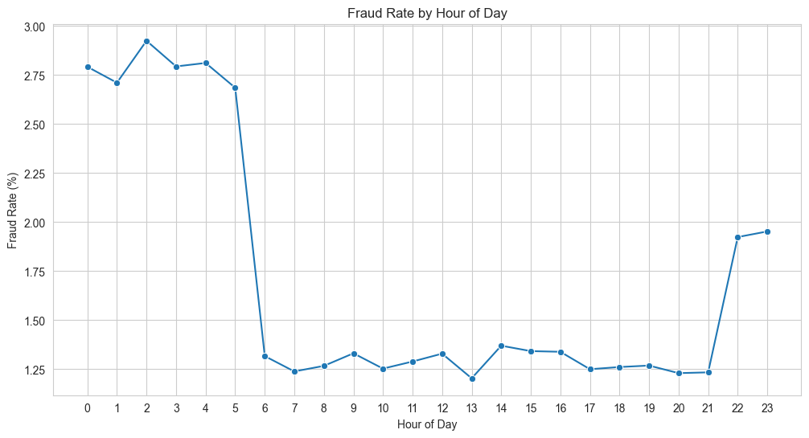
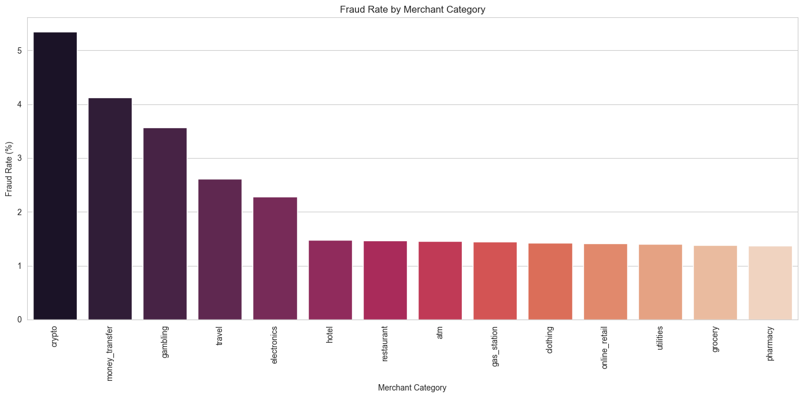
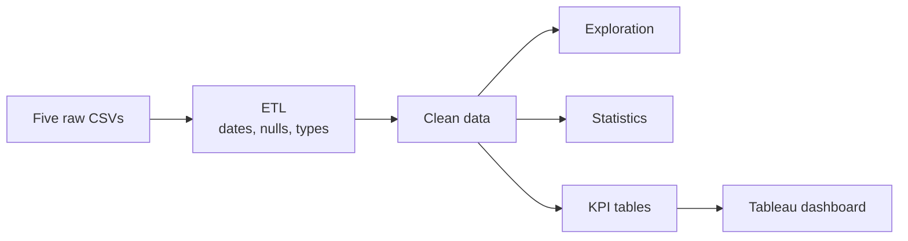

<div align="center">

# Transaction Fraud Analysis

**One million card transactions, 17,143 of them fraudulent.<br>What do the fraudulent ones have in common?**


[**Open the dashboard**](https://public.tableau.com/app/profile/manas.saxena/viz/FraudDetectionAnalysis_17774564367470/FraudMonitoringDashboard) ·
[Findings](#findings) ·
[Run it](#run-it) ·
[Data](#data) ·
[Credits](#credits)

</div>

---

## At a glance

| Transactions | Accounts | Fraud cases | Fraud rate | Fraud value | Period |
| :--: | :--: | :--: | :--: | :--: | :--: |
| 1,000,000 | 50,000 | 17,143 | 1.71% | $12.52M | 2022 to 2024 |

Fraud is 1.71% of transactions but **6.8% of the money**: $12.52M of $183.74M.

## Findings

### 1. A new device is the clearest warning

| Signal | Fraud rate when true | Fraud rate when false | Difference |
| :-- | --: | --: | --: |
| Device not seen before | **8.72%** | 0.87% | 10x |
| Foreign transaction | **3.40%** | 1.01% | 3.4x |
| Between 00:00 and 05:59 | **2.79%** | 1.36% | 2.1x |
| Account without 2FA | **2.03%** | 1.54% | 1.3x |

### 2. Fraud comes fast and from risky addresses

| Average | Legitimate | Fraudulent |
| :-- | --: | --: |
| Transactions in the previous hour | 1.00 | **3.97** |
| IP risk score (0 to 100) | 21.0 | **55.4** |
| Amount, mean | $174 | **$730** |
| Amount, median | $80 | **$241** |

Transaction velocity has the strongest correlation with fraud (0.35), ahead of IP risk (0.27) and amount (0.23).

### 3. Night is the risky time

A quarter of transactions happen between midnight and 05:59, but they carry **40.7%** of the fraud. The day of the week barely matters.



### 4. Five merchant categories stand out

Crypto (5.34%), money transfer (4.13%), gambling (3.57%), travel (2.61%) and electronics (2.28%). Every other category sits near 1.4%.



### 5. The most common fraud isn't the only costly one

| Type | Cases | Share | Average | Total |
| :-- | --: | --: | --: | --: |
| Card not present | 5,982 | 34.9% | $772 | **$4.62M** |
| Account takeover | 3,432 | 20.0% | $1,203 | **$4.13M** |
| Stolen card, present | 3,120 | 18.2% | $557 | $1.74M |
| Identity theft | 656 | 3.8% | $1,164 | $0.76M |
| Friendly fraud | 1,726 | 10.1% | $353 | $0.61M |
| ATM fraud | 1,216 | 7.1% | $466 | $0.57M |
| Money laundering | 1,011 | 5.9% | $94 | $0.09M |

Account takeover has 43% fewer cases than card not present, yet costs almost as much.

### 6. The account risk score doesn't help

Accounts with and without fraud have the same average risk score (19.91). Behaviour at the time of the transaction tells you more than the account's history.

## How it works



| Step | Where |
| :-- | :-- |
| Load and inspect | [`01_extraction`](notebooks/01_extraction.ipynb) |
| Clean | [`02_cleaning`](notebooks/02_cleaning.ipynb), [`scripts/`](scripts) |
| Explore | [`03_eda`](notebooks/03_eda.ipynb) |
| Test and correlate | [`04_statistical_analysis`](notebooks/04_statistical_analysis.ipynb) |
| Merge and build KPIs | [`05_final_load_prep`](notebooks/05_final_load_prep.ipynb) |

## Run it

You need Python 3.10 or later and about 400 MB of free space.

```bash
git clone https://github.com/ManasSaxena14/TransactionsFraudDetection_Tableau.git
cd TransactionsFraudDetection_Tableau

python -m venv .venv && source .venv/bin/activate
pip install -r requirements.txt scipy

# The transactions file (128 MB) is too large for this repository
curl -L -o data/raw/transactions.csv \
  https://media.githubusercontent.com/media/AnanyaSoni2004/E_G14_TransactionsFraudDetection/main/data/raw/transactions.csv

python -m scripts.etl_pipeline
jupyter notebook notebooks/
```

The pipeline finishes with `Transactions: (1000000, 27)`. Run it before notebooks 03 to 05, which read its output.

## Data

| File | Rows | What it holds |
| :-- | --: | :-- |
| `transactions.csv` | 1,000,000 | Amount, merchant, device, location, velocity and the fraud label |
| `account_profiles.csv` | 50,000 | Account totals, risk score and 2FA status |
| `time_series_stats.csv` | 26,280 | Hourly totals over three years |
| `network_edges.csv` | 7,411 | Accounts sharing an IP, device, email domain or phone, in 200 rings |
| `fraud_patterns.csv` | 7 | Summary of each fraud type |

Every column is described in the [data dictionary](docs/data_dictionary.md).

## Limits

- These are patterns in one dataset, not proof of cause, and no fraud model is trained here.
- 59.5% of linked account pairs are both fraudulent, but the links were not sampled at random, so that is not a general rate.
- In notebook 03, the legends on the amount and risk score charts have their labels swapped.
- `data/processed/` holds Git LFS pointers. The pipeline replaces them with real files.

## Credits

The analysis, code, notebooks and data dictionary come from [E_G14_TransactionsFraudDetection](https://github.com/AnanyaSoni2004/E_G14_TransactionsFraudDetection), a Data Visualization and Analytics capstone by team E_G14 at Newton School of Technology.

This repository adds a published [Tableau dashboard](https://public.tableau.com/app/profile/manas.saxena/viz/FraudDetectionAnalysis_17774564367470/FraudMonitoringDashboard), a fresh run of the pipeline with the findings rechecked, and this documentation.
